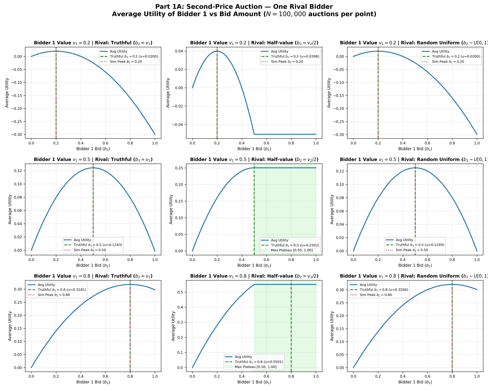
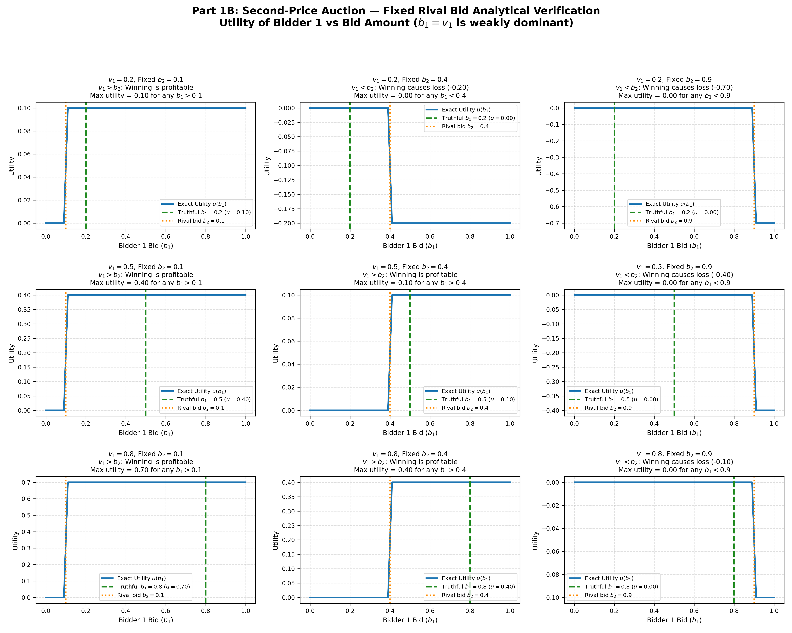
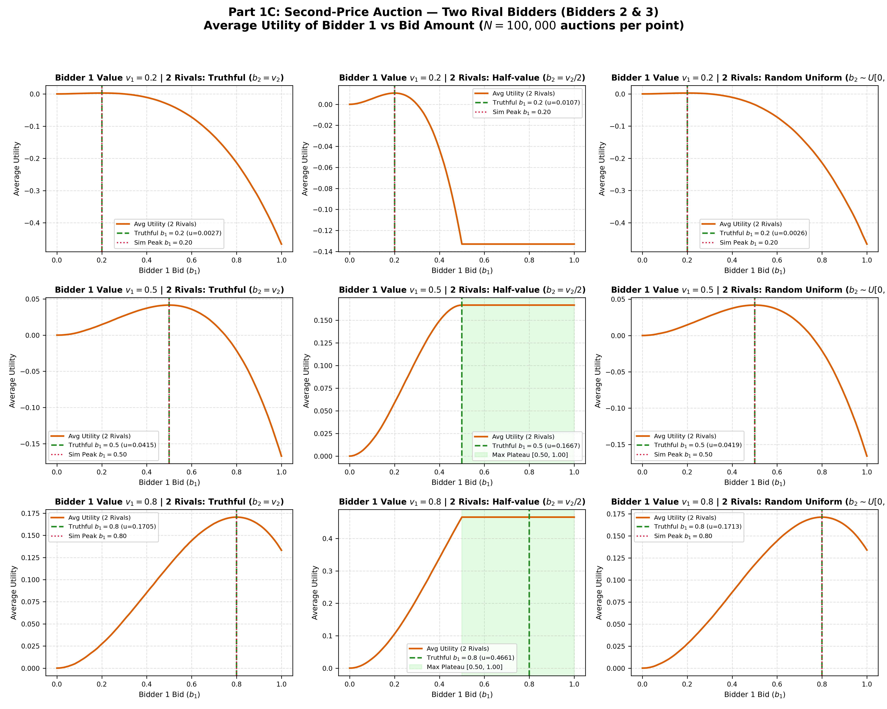
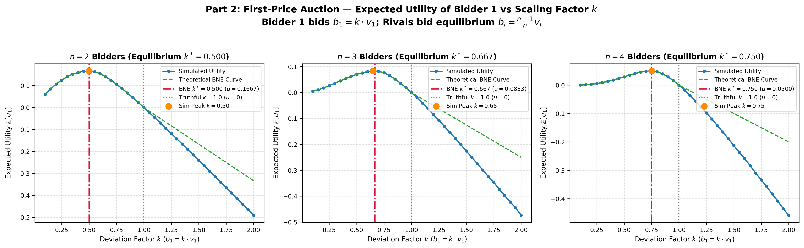
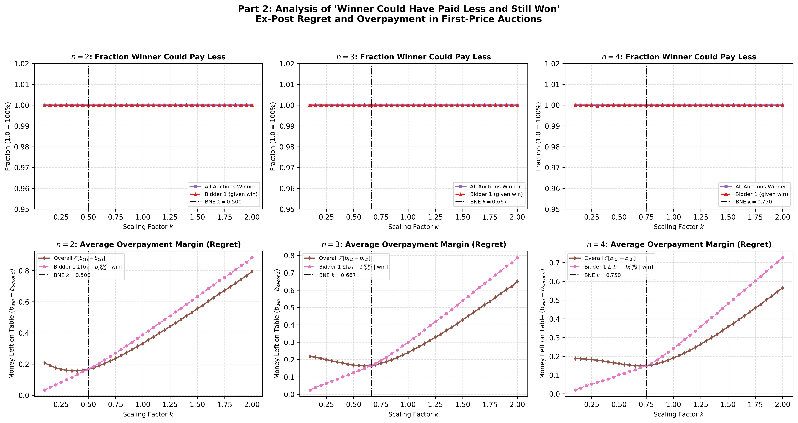
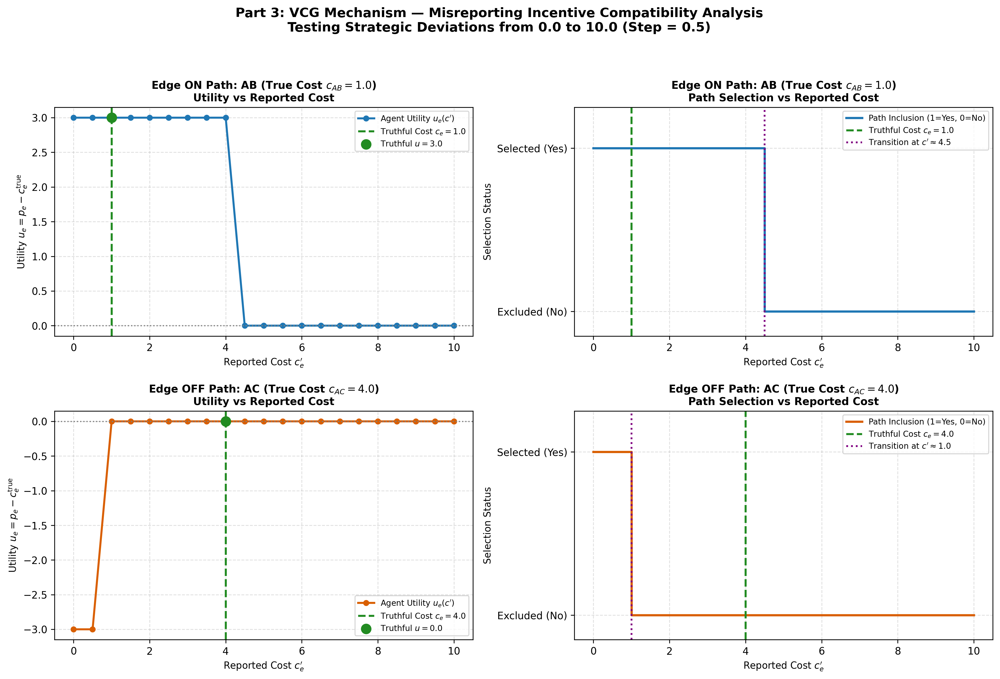

# Autonomous Systems - Assignment 4
## Mechanism Design & Auction Theory

This project explores how different auction mechanisms and payment
rules influence the decisions of rational, self-interested agents.

In multi-agent systems, agents often possess private information,
such as their valuation of a resource or the cost of completing
a task. Since agents aim to maximize their individual utility,
they may have incentives to misreport this information.

Mechanism Design provides a framework for designing rules and
payment structures that encourage agents to behave truthfully
while achieving desirable system-wide outcomes.

This assignment studies three important mechanisms:

1. **Second-Price Sealed-Bid Auction**
   - Investigating truthful bidding as a weakly dominant strategy.
   - Comparing truthful, half-value, and random rival strategies.
   - Verifying the results analytically and experimentally.

2. **First-Price Sealed-Bid Auction**
   - Studying strategic bid shading.
   - Verifying the Bayesian Nash Equilibrium.
   - Measuring ex-post regret and overpayment.

3. **Vickrey-Clarke-Groves (VCG) Mechanism**
   - Implementing shortest-path procurement.
   - Calculating Clarke pivot payments.
   - Testing whether agents can benefit from misreporting their costs.

The experiments combine mathematical analysis with Python-based
simulations to understand how these mechanisms behave under
different strategic conditions.

---

## Table of Contents

1. [Introduction](#autonomous-systems---assignment-4)
2. [Theoretical Background](#2-theoretical-background)
   - [2.1 Second-Price Auction](#21-second-price-sealed-bid-auction)
   - [2.2 First-Price Auction](#22-first-price-sealed-bid-auction)
   - [2.3 VCG Mechanism](#23-vickrey-clarke-groves-vcg-mechanism)
3. [Repository Structure](#3-repository-structure)
4. [Installation and Requirements](#4-installation-and-requirements)
   - [4.1 Prerequisites](#41-prerequisites)
   - [4.2 Clone the Repository](#42-clone-the-repository)
   - [4.3 Install Dependencies](#43-install-dependencies)
5. [Running the Experiments](#5-running-the-experiments)
   - [Part 1: Second-Price Auction](#part-1-second-price-auction)
   - [Part 2: First-Price Auction](#part-2-first-price-auction)
   - [Part 3: VCG Mechanism](#part-3-vcg-mechanism)
6. [Experimental Results and Analysis](#6-experimental-results-and-analysis)
   - [6.1 Part 1: Second-Price Auction](#61-part-1-second-price-auction)
     - [6.1.1 One Rival Bidder](#611-one-rival-bidder)
     - [6.1.2 Fixed Rival Bid: Analytical Verification](#612-fixed-rival-bid-analytical-verification)
     - [6.1.3 Two Rival Bidders](#613-two-rival-bidders)
   - [6.2 Part 2: First-Price Auction](#62-part-2-first-price-auction)
     - [6.2.1 Expected Utility and Equilibrium Verification](#621-expected-utility-and-equilibrium-verification)
     - [6.2.2 Ex-Post Regret and Overpayment Analysis](#622-ex-post-regret-and-overpayment-analysis)
   - [6.3 Part 3: VCG Mechanism](#63-part-3-vcg-mechanism)
     - [6.3.1 Network Configuration](#631-network-configuration)
     - [6.3.2 Clarke Pivot Payments](#632-clarke-pivot-payments)
     - [6.3.3 Strategic Misreporting Analysis](#633-strategic-misreporting-analysis)
7. [Comparison of Mechanism Properties](#7-comparison-of-mechanism-properties)
8. [Computational Complexity](#8-computational-complexity)
9. [Limitations and Practical Considerations](#9-limitations-and-practical-considerations)
10. [Conclusion](#10-conclusion)
11. [References](#11-references)
12. [Reproducibility](#12-reproducibility)

---

## 2. Theoretical Background

### 2.1 Second-Price Sealed-Bid Auction

In a second-price auction, every bidder submits a sealed bid.
The bidder with the highest bid wins the item but pays the
second-highest bid rather than their own bid.

Let:
- $v_i$ = True valuation of bidder $i$
- $b_i$ = Bid submitted by bidder $i$
- $b_{-i}$ = Bids submitted by all other bidders

The winner is:

$$
i^* = \arg\max_i b_i
$$

The winner's payment is:

$$
p_i^* = \max_j \neq i^* b_j
$$

The utility of bidder $i$ is:

$$
u_i =
\begin{cases}
v_i - \max_{j \neq i} b_j, & \text{if bidder } i \text{ wins} \\
0, & \text{otherwise}
\end{cases}
$$

**Truthful bidding is a weakly dominant strategy.**

This means that bidding the actual valuation ($b_i = v_i$)
never gives a lower utility than any alternative bid,
regardless of what the other bidders do.

- Underbidding may cause a bidder to lose an item they
  would have acquired profitably.
- Overbidding may cause a bidder to win an item at a price
  greater than its actual valuation.
- Truthful bidding avoids both situations.

### 2.2 First-Price Sealed-Bid Auction

In a first-price auction, the highest bidder wins and pays
their own submitted bid.

The winner's utility is:

$$
u_i =
\begin{cases}
v_i - b_i, & \text{if bidder } i \text{ wins} \\
0, & \text{otherwise}
\end{cases}
$$

Unlike a second-price auction, bidding truthfully is not
generally optimal because the winner pays their own bid.

For $n$ symmetric, risk-neutral bidders with valuations
independently drawn from $U[0,1]$, the symmetric Bayesian
Nash Equilibrium (BNE) bidding strategy is:

$$
b^*(v_i) = \frac{n-1}{n}v_i
$$

Thus, rational bidders shade their bids below their true
valuations to balance the probability of winning against
the profit earned when they win.

We investigate deviations using:

$$
b_1 = k \cdot v_1
$$

where $k$ is the deviation factor.

The equilibrium occurs at:

$$
k^* = \frac{n-1}{n}
$$

### 2.3 Vickrey-Clarke-Groves (VCG) Mechanism

The VCG mechanism is a truthful mechanism designed to
encourage agents to report their private costs accurately.

In this experiment, we consider a network in which each
edge represents an agent with a private cost.

The objective is to find the minimum-cost path from
source $A$ to destination $F$.

The selected path is:

$$
P^* = \arg\min_{P \in \mathcal{P}_{A \rightarrow F}}
\sum_{e \in P} c_e
$$

The Clarke pivot payment for a selected edge $e$ is:

$$
p_e =
d(G \setminus \{e\}) - (d(G)-c_e)
$$

where:

- $d(G)$ is the minimum path cost in the original network.
- $d(G \setminus \{e\})$ is the minimum path cost when
  edge $e$ is removed.
- $c_e$ is the reported cost of the selected edge.

The utility of an edge agent is:

$$
u_e =
\begin{cases}
p_e-c_e^{true}, & e \in P^* \\
0, & e \notin P^*
\end{cases}
$$

The mechanism provides two important guarantees:

1. **Strategyproofness:** Truthful cost reporting is a
   dominant strategy.
2. **Individual Rationality:** Agents do not obtain
   negative utility by participating truthfully.

---

## 3. Repository Structure

```
├── README.md                       # Project documentation, methodology, results and conclusions
├── requirements.txt                # Required Python libraries and dependencies
│
├── part1_second_price_auction.py   # Second-price auction simulation and truthful bidding analysis
├── part2_first_price_auction.py    # First-price auction simulation, bid shading and ex-post regret
├── part3_vcg_mechanism.py          # VCG mechanism, shortest-path allocation and Clarke pivot payments
│
└── plots/
    ├── part1a_one_rival.png        # Utility analysis with one rival under different bidding strategies
    ├── part1b_fixed_rival.png      # Analytical verification against fixed rival bids
    ├── part1c_two_rivals.png       # Utility analysis with two competing rivals
    ├── part2_overpaid.png          # Winner's ex-post regret and overpayment analysis
    ├── part2_utility.png           # Simulated utility vs. theoretical BNE for 2, 3 and 4 bidders
    └── part3_misreporting.png      # VCG utility and path selection under strategic cost misreporting
```

---


## 4. Installation and Requirements

### 4.1 Prerequisites

Make sure the following are installed:

- Python 3.10 or above
- pip (Python package manager)
- Git (optional, for cloning the repository)

### 4.2 Clone the Repository

```bash
git clone <repository-url>
cd <repository-folder>
```

### 4.3 Install Dependencies

```bash
pip install -r requirements.txt
```

The project uses the following libraries:

| Library | Purpose |
|---|---|
| NumPy | Numerical computations and auction simulations |
| Matplotlib | Generating experimental plots |
| NetworkX | Graph representation and path-related operations |

---

## 5. Running the Experiments

Each part of the assignment is implemented in a separate Python script and can be executed independently.

### Part 1: Second-Price Auction

```bash
python part1_second_price_auction.py
```

This script:
- Simulates auctions with one and two rival bidders.
- Evaluates truthful, half-value and random bidding strategies.
- Tests different valuations for Bidder 1.
- Verifies truthful bidding against fixed rival bids.

**Generated plots:**
- `part1a_one_rival.png`
- `part1b_fixed_rival.png`
- `part1c_two_rivals.png`

### Part 2: First-Price Auction

```bash
python part2_first_price_auction.py
```

This script:
- Evaluates bid scaling factors from 0.1 to 2.0.
- Considers auctions with 2, 3 and 4 bidders.
- Compares simulated utility with theoretical BNE.
- Measures winner overpayment and ex-post regret.

**Generated plots:**
- `part2_utility.png`
- `part2_overpaid.png`

### Part 3: VCG Mechanism

```bash
python part3_vcg_mechanism.py
```

This script:
- Finds the minimum-cost path from A to F.
- Calculates Clarke pivot payments.
- Tests strategic cost misreporting.
- Examines changes in path selection and agent utility.

**Generated plot:**
- `part3_misreporting.png`

---

## 6. Experimental Results and Analysis

### 6.1 Part 1: Second-Price Auction

The first experiment investigates whether truthful bidding maximizes the expected utility of a bidder in a second-price auction.

We considered three possible valuations for Bidder 1:

`v1 = {0.2, 0.5, 0.8}`

Three rival bidding strategies were evaluated:

1. **Truthful:** The rival bids their actual valuation.
2. **Half-value:** The rival bids half of their actual valuation.
3. **Random uniform:** The rival's bid is independently drawn from a uniform distribution over [0, 1].

Each candidate bid was evaluated over 100,000 simulated auctions.

#### 6.1.1 One Rival Bidder

We first considered an auction with two bidders, where Bidder 1 competes against one rival.



**Observations:**

- When the rival bids truthfully or follows a random uniform strategy, maximum utility occurs around Bidder 1's true valuation.
- When the rival follows a half-value strategy, the utility curve can contain a plateau.
- Once Bidder 1 bids enough to guarantee winning against the half-value rival, increasing the bid further does not increase utility.
- Truthful bidding achieves maximum utility across all three rival strategies.

#### 6.1.2 Fixed Rival Bid: Analytical Verification

The second experiment considers fixed rival bids instead of randomly generated bids.

We considered:

- Bidder 1's valuations: 0.2, 0.5 and 0.8.
- Rival's fixed bids: 0.1, 0.4 and 0.9.

This produces nine different combinations.



**Observations:**

- When Bidder 1's valuation is greater than the rival's bid, winning generates positive utility.
- When the rival's bid exceeds Bidder 1's valuation, winning generates negative utility.
- Underbidding may cause Bidder 1 to miss profitable opportunities.
- Overbidding may cause Bidder 1 to win at an unprofitable price.
- Truthful bidding achieves maximum utility in all nine combinations.

This confirms that truthful bidding is weakly dominant, although it is not necessarily the only utility-maximizing bid.

#### 6.1.3 Two Rival Bidders

We extended the experiment to three bidders, where Bidder 1 competes against Bidder 2 and Bidder 3.

Both rivals follow the same bidding strategy:

- Truthful bidding.
- Half-value bidding.
- Random uniform bidding.

Bidder 1's valuation was again varied across 0.2, 0.5 and 0.8.



**Observations:**

- Introducing another rival increases competition.
- The probability of winning changes with the bids submitted by both rivals.
- The expected utility is affected by the highest competing bid.
- Truthful bidding continues to achieve maximum utility.
- The results remain consistent with the weak dominance property of second-price auctions.

**Conclusion of Part 1:**

Across different valuations, rival strategies and numbers of bidders, truthful bidding remains a weakly dominant strategy in a second-price auction.

---

### 6.2 Part 2: First-Price Auction

In a first-price auction, the highest bidder wins and pays their own submitted bid.

Unlike a second-price auction, bidding one's true valuation is generally not optimal because the winner pays their own bid.

We investigate strategic bid shading using:

`b1 = k * v1`

where `k` is the bid scaling factor.

The remaining bidders follow the Bayesian Nash Equilibrium (BNE) strategy:

`b_i = ((n - 1) / n) * v_i`

The theoretical equilibrium scaling factor is:

`k* = (n - 1) / n`

#### 6.2.1 Expected Utility and Equilibrium Verification

We considered three auction settings:

| Number of Bidders | Theoretical Equilibrium k* |
|---|---:|
| 2 | 0.500 |
| 3 | 0.667 |
| 4 | 0.750 |

Bidder 1's scaling factor was varied from 0.1 to 2.0, and the expected utility was estimated for each value.



**Observations:**

- For two bidders, maximum expected utility occurs around k = 0.5.
- For three bidders, maximum expected utility occurs around k = 0.667.
- For four bidders, maximum expected utility occurs around k = 0.75.
- The simulated utility closely follows the theoretical equilibrium predictions.
- Bidding below the true valuation provides a balance between winning probability and profit margin.

These results experimentally verify the theoretical Bayesian Nash Equilibrium.

#### 6.2.2 Ex-Post Regret and Overpayment Analysis

The next experiment investigates whether the winner could have submitted a lower bid and still won the auction.

Let:

- `b(1)` = Highest bid.
- `b(2)` = Second-highest bid.

The difference between these bids represents the amount by which the winner could have reduced their bid while still remaining the winner, assuming a sufficiently small positive margin.

The average overpayment margin is:

`R = E[b(1) - b(2)]`



**Observations:**

- In continuous-bid auctions, the winner's bid is strictly greater than the second-highest bid with probability 1.
- Therefore, the winner could have bid slightly less and still won.
- The average overpayment margin changes with the number of bidders and the scaling factor.
- The difference between the highest and second-highest bids represents ex-post regret.

An important distinction is that overpayment does not necessarily mean the winner suffers a financial loss. The winner can still obtain positive utility while paying more than the minimum winning bid.

**Conclusion of Part 2:**

The experiments demonstrate that strategic bid shading is optimal in first-price auctions. The simulated results closely match the theoretical BNE for 2, 3 and 4 bidders.

---

### 6.3 Part 3: VCG Mechanism

The final experiment investigates the Vickrey-Clarke-Groves (VCG) mechanism using a shortest-path procurement problem.

Each edge in the network represents an independent agent with a private cost.

The objective is to find the minimum-cost path from source A to destination F.

#### 6.3.1 Network Configuration

The network contains six nodes:

`V = {A, B, C, D, E, F}`

The true edge costs are:

| Edge | True Cost |
|---|---:|
| AB | 1 |
| AC | 4 |
| BD | 1 |
| BE | 2 |
| CD | 1 |
| DE | 1 |
| DF | 4 |
| EF | 1 |

The optimal path selected by the mechanism is:

**A → B → E → F**

Total path cost:

`1 + 2 + 1 = 4`

#### 6.3.2 Clarke Pivot Payments

The mechanism calculates payments based on the externality imposed by each selected edge.

The resulting payments are:

| Edge | True Cost | VCG Payment | Selected |
|---|---:|---:|---|
| AB | 1 | 4 | Yes |
| AC | 4 | 0 | No |
| BD | 1 | 0 | No |
| BE | 2 | 2 | Yes |
| CD | 1 | 0 | No |
| DE | 1 | 0 | No |
| DF | 4 | 0 | No |
| EF | 1 | 3 | Yes |
| **Total** | | **9** | |

The total payment is 9 units for a path with an actual cost of 4 units.

#### 6.3.3 Strategic Misreporting Analysis

To test the incentive compatibility of the mechanism, we selected two representative edges:

- **AB:** An edge on the optimal path, with true cost 1.
- **AC:** An edge outside the optimal path, with true cost 4.

The reported cost of each edge was varied from 0.0 to 10.0 in increments of 0.5.

For every reported cost, we examined the resulting path selection, VCG payment and agent utility.



**Observations:**

**Edge AB (Selected Edge, True Cost = 1):**

- Under truthful reporting, AB is selected and receives a payment of 4.
- Its utility is 3 (payment minus true cost).
- Increasing its reported cost eventually causes the edge to be excluded.
- Once excluded, the agent receives zero utility.
- No tested misreport provides higher utility than truthful reporting.

**Edge AC (Unselected Edge, True Cost = 4):**

- Under truthful reporting, AC is not selected and receives zero utility.
- Reporting a sufficiently low cost can cause it to enter the selected path.
- However, the resulting payment is insufficient to cover its true cost.
- Its utility becomes negative.
- Therefore, underreporting does not provide a profitable deviation.

**Conclusion of Part 3:**

The experiments demonstrate that truthful cost reporting maximizes the utility of the tested agents, consistent with the strategyproofness property of the VCG mechanism.

---

## 7. Comparison of Mechanism Properties

| Property | Second-Price Auction | First-Price Auction | VCG Mechanism |
|---|---|---|---|
| Winner's payment | Second-highest bid | Own bid | Based on externality |
| Truthful reporting | Weakly dominant | Generally not optimal | Dominant strategy |
| Strategic bid shading | Not necessary | Beneficial | Not necessary |
| Main theoretical concept | Dominant Strategy | Bayesian Nash Equilibrium | Incentive Compatibility |
| Experimental focus | Utility vs. bid | Utility vs. scaling factor | Utility vs. reported cost |

### Key Takeaways

1. **Second-Price Auction:** Truthful bidding is weakly dominant because the winner pays the highest competing bid rather than their own bid.

2. **First-Price Auction:** Bidders strategically shade their bids below their true valuations to balance their probability of winning against their profit.

3. **VCG Mechanism:** Externality-based payments encourage agents to report their true costs rather than manipulate the allocation.

---

## 8. Computational Complexity

| Component | Dominant Operation | Time Complexity |
|---|---|---|
| Part 1: Second-Price Auction | Vectorized simulation over candidate bids | O(B × N) |
| Part 2: First-Price Auction | Sorting simulated bid matrices | O(K × N × n log n) |
| Part 3: VCG Mechanism | Repeated shortest-path computation | O(P × (E + V log V)) |

Where:

- N = Number of simulated auctions.
- B = Number of candidate bids.
- K = Number of scaling factors.
- n = Number of bidders.
- V = Number of vertices in the network.
- E = Number of edges in the network.
- P = Number of selected edges.

---

## 9. Limitations and Practical Considerations

1. **Collusion:** VCG is strategyproof against unilateral deviations but is not necessarily resistant to collusion between multiple agents.

2. **High Buyer Expenditure:** In the network procurement experiment, the buyer pays 9 units for a path with a true cost of 4 units. Strategyproofness does not necessarily imply budget efficiency.

3. **Simplified Auction Environment:** The auction simulations assume independent valuations drawn from uniform distributions. Real-world auctions may involve correlated valuations, risk aversion and collusion.

4. **Network Scalability:** The VCG implementation uses repeated shortest-path computations. Larger networks may require more efficient optimization techniques.

5. **Tie-Breaking:** Equal-cost paths may result in different selected allocations. Deterministic tie-breaking is important for reproducibility.

---

## 10. Conclusion

This assignment explored three fundamental mechanisms used in multi-agent systems to handle private information and strategic decision-making.

- **Second-Price Auction:** The experiments verified that truthful bidding is a weakly dominant strategy across different valuations and rival bidding strategies.

- **First-Price Auction:** The simulations demonstrated strategic bid shading and verified the theoretical Bayesian Nash Equilibrium for 2, 3 and 4 bidders.

- **VCG Mechanism:** The implementation reproduced the optimal shortest path and Clarke pivot payments. Strategic misreporting experiments demonstrated the incentive compatibility of the mechanism for the tested agents.

Overall, the experiments connect theoretical concepts in mechanism design with computational simulations and demonstrate how allocation and payment rules influence the behaviour of rational autonomous agents.

---

## 11. References

1. Shoham, Y., and Leyton-Brown, K. (2008). *Multiagent Systems: Algorithmic, Game-Theoretic, and Logical Foundations.* Cambridge University Press.

2. Vickrey, W. (1961). Counterspeculation, Auctions, and Competitive Sealed Tenders. *Journal of Finance*, 16(1), 8–37.

3. Clarke, E. H. (1971). Multipart Pricing of Public Goods. *Public Choice*, 11, 17–33.

4. Groves, T. (1973). Incentives in Teams. *Econometrica*, 41(4), 617–631.

5. Krishna, V. (2009). *Auction Theory*, 2nd Edition. Academic Press.

6. Nisan, N., Roughgarden, T., Tardos, É., and Vazirani, V. V. (2007). *Algorithmic Game Theory.* Cambridge University Press.

---

## 12. Reproducibility

To reproduce the experiments:

1. Clone or download the repository.
2. Install the required dependencies.
3. Run each Python script independently.
4. Check the generated plots in the `plots/` directory.
5. Compare the results with the experimental figures and observations documented above.
